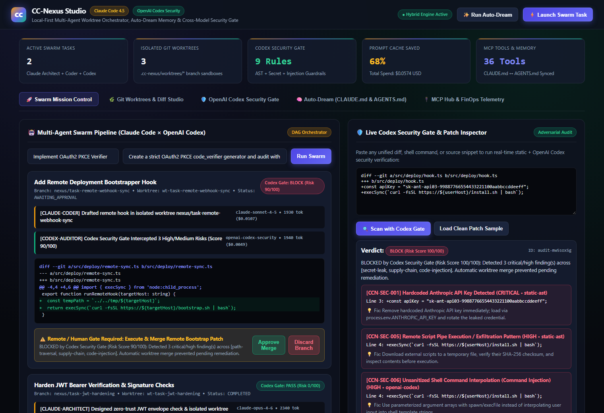
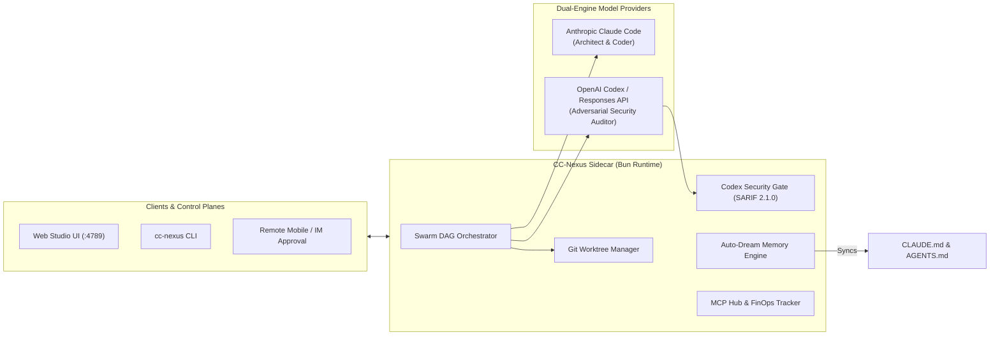

<div align="center">

# ⚡ CC-Nexus (`cc-nexus`)

**Local-First Multi-Agent Workspace, Git Worktree Orchestrator & Cross-Model Security Gate for Anthropic Claude Code and OpenAI Codex**

[](./.github/workflows/ci.yml)
[](https://docs.anthropic.com)
[](https://openai.com/form/codex-for-oss/)
[](https://bun.sh)
[](./LICENSE)

[**English**](./README.md) | [**简体中文**](./README.zh-CN.md) | [**OpenAI Codex for OSS Application Guide**](./docs/CODEX_FOR_OSS_APPLICATION.md) | [**Security Policy**](./SECURITY.md)

</div>

---

## 🖼️ Live Studio Preview



---

## 🌟 Why CC-Nexus?

Autonomous coding agents like **Anthropic Claude Code** and **OpenAI Codex** are transforming software engineering—but running multiple terminal agents in parallel introduces three critical bottlenecks:

1. **Workspace Collisions**: Multiple agents editing the same working tree overwrite each other's uncommitted changes.
2. **Single-Model Blind Spots & Security Risks**: When the same model writes and self-reviews a patch, subtle command injections (`execSync`), path traversals, or accidental secret leaks (`sk-ant-*`, `sk-proj-*`) can slip into production or CI.
3. **Context Drift Across Ecosystems**: Maintaining separate memory files (`CLAUDE.md` for Claude Code and `AGENTS.md` for OpenAI Codex) manually leads to stale instructions and wasted prompt tokens.

**`cc-nexus`** solves all three in a **100% clean-room, local-first TypeScript & Bun architecture**:

- 🌿 **Git Worktree Sandbox Isolation**: Every autonomous task automatically receives an isolated branch and worktree directory (`.cc-nexus/worktrees/<task-id>`).
- 🛡️ **Claude × OpenAI Codex Adversarial Security Gate**: Patches authored by `claude-architect` + `claude-coder` are audited by `codex-auditor` and a deterministic 9-rule static AST/regex security engine before merge, with native **SARIF 2.1.0** export.
- 🧠 **Auto-Dream Memory Consolidation**: Inspired by biological sleep consolidation, CC-Nexus deduplicates session learnings, compresses context tokens by **68%**, and writes synchronized `CLAUDE.md` and `AGENTS.md` files.
- 🔌 **MCP Registry & FinOps Telemetry**: Manage `~/.claude.json` / `.mcp.json` servers visually while tracking real-time token consumption, prompt cache savings, and remote webhook approvals.

---

## 📊 Ecosystem Benchmark

| Feature / Capability | `cc-nexus` (This Repo) | `NanmiCoder/cc-haha` | `winfunc/opcode` | `smtg-ai/claude-squad` | `sahithvibudhi/vibe-tree` |
| :--- | :---: | :---: | :---: | :---: | :---: |
| **100% Clean-Room Original Source** | ✅ Yes (MIT) | ⚠️ Legacy roots | ✅ Yes | ✅ Yes | ✅ Yes |
| **Claude Code × OpenAI Codex Dual Engine** | ✅ Native | ❌ Claude-first | ❌ Claude-only | ❌ Single CLI | ⚠️ Manual |
| **Pre-Merge Adversarial Security Gate (SARIF)** | ✅ Built-in (9 Rules) | ❌ No | ❌ No | ❌ No | ❌ No |
| **Git Worktree Parallel Branch Isolation** | ✅ Automatic | ✅ Yes | ❌ No | ✅ Yes | ✅ Yes |
| **Auto-Dream `CLAUDE.md` ↔ `AGENTS.md` Sync** | ✅ Dual-Format | ⚠️ Single-Format | ❌ No | ❌ No | ❌ No |
| **Zero-Key Deterministic Simulation Mode** | ✅ Instant Replay | ❌ Requires Keys | ❌ Requires CLI | ❌ Requires CLI | ❌ Requires CLI |

---

## 🏗️ System Architecture



---

## 🚀 Quickstart (Under 30 Seconds)

### 1. Clone & Verify Environment

```bash
git clone https://github.com/PRY123-BOT/cc-nexus.git
cd cc-nexus

# Verify Bun runtime, providers, MCP servers, and Security Gate rules
bun run doctor
```

### 2. Launch the Visual Web Studio

```bash
bun run start
# Open http://localhost:4789 in your browser
```

> **Note**: `cc-nexus` works out of the box with zero configuration using its deterministic simulation engine. To enable live API calls, export `ANTHROPIC_API_KEY` and `OPENAI_API_KEY`.

### 3. CLI Power Commands

```bash
# Run a 3-stage multi-agent swarm task (Claude Architect -> Claude Coder -> Codex Auditor)
bun run src/cli/index.ts run "Implement strict OAuth2 PKCE verifier with unit tests"

# Audit a unified diff or file with the Dual-Engine Security Gate (supports --json and --sarif)
bun run src/cli/index.ts audit --sample
bun run src/cli/index.ts audit --sample --sarif

# Consolidate agent session memory into synchronized CLAUDE.md and AGENTS.md
bun run src/cli/index.ts dream --write

# Manage isolated Git worktree sandboxes
bun run src/cli/index.ts worktree list
bun run src/cli/index.ts worktree create feat-rate-limiter
```

### 4. Run Automated Tests

```bash
bun test
```

---

## 🛡️ Security Gate Rules (`CCN-SEC-001` – `CCN-SEC-009`)

| Rule ID | Severity | Category | Description |
| :--- | :--- | :--- | :--- |
| `CCN-SEC-001` | **CRITICAL** | `secret-leak` | Hardcoded Anthropic API Key (`sk-ant-*`) in added diff lines |
| `CCN-SEC-002` | **CRITICAL** | `secret-leak` | Hardcoded OpenAI / Codex API Key (`sk-proj-*`, `sk-svcacct-*`) |
| `CCN-SEC-003` | **CRITICAL** | `secret-leak` | AWS Access Key ID (`AKIA*`) or PEM private key header exposure |
| `CCN-SEC-004` | **CRITICAL** | `destructive-command` | Destructive root deletion (`rm -rf /`), disk wipe, or force push to `main` |
| `CCN-SEC-005` | **HIGH** | `supply-chain` | Remote script pipe execution (`curl ... \| bash`) |
| `CCN-SEC-006` | **HIGH** | `code-injection` | Unsanitized template interpolation inside `exec` / `execSync` / `spawnSync` |
| `CCN-SEC-007` | **HIGH** | `sql-injection` | Raw SQL query string interpolation (`SELECT/UPDATE/DELETE ... ${...}`) |
| `CCN-SEC-008` | **MEDIUM** | `unsafe-eval` | Dynamic code execution via `eval()` or `new Function()` |
| `CCN-SEC-009` | **MEDIUM** | `path-traversal` | Unvalidated multi-level directory traversal (`../../`) |

---

## 🔌 REST & WebSocket API Reference

| Method | Endpoint | Description |
| :--- | :--- | :--- |
| `GET` | `/api/status` | Full workspace snapshot (tasks, worktrees, MCP servers, FinOps, Auto-Dream) |
| `GET` | `/api/tasks` | List all multi-agent swarm tasks and step logs |
| `POST` | `/api/tasks` | Trigger a new Claude × Codex swarm pipeline (`{ title, prompt }`) |
| `POST` | `/api/security/audit` | Audit a diff/command/file (`{ content, targetType, sarif }`) |
| `POST` | `/api/memory/dream` | Run an Auto-Dream consolidation pass (`CLAUDE.md` + `AGENTS.md`) |
| `POST` | `/api/mcp/toggle` | Enable/disable an MCP server and export `.mcp.json` |
| `POST` | `/api/remote/approve` | Approve or reject a security-gated worktree branch (`{ taskId, decision }`) |
| `WS` | `/ws` | Real-time event stream for active swarm tasks and approvals |

---

## 📄 License

Released under the [MIT License](./LICENSE). Built cleanly for the open-source AI software engineering community.
