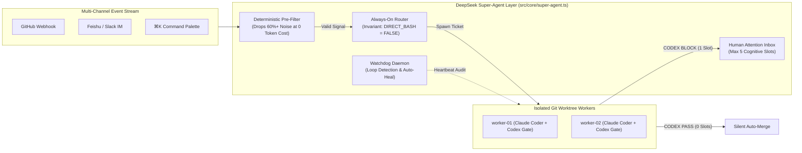

<div align="center">

# CC-Nexus v2.0 (`cc-nexus`)

**Autonomous Super-Agent Control Plane, Git Worktree Orchestrator & Adversarial Security Gate for Anthropic Claude Code and OpenAI Codex**

[](./.github/workflows/ci.yml)
[](./src/core/super-agent.ts)
[](https://docs.anthropic.com)
[](https://openai.com/form/codex-for-oss/)
[](https://bun.sh)
[](./LICENSE)

[**English**](./README.md) | [**简体中文**](./README.zh-CN.md) | [**OpenAI Codex for OSS Application Guide**](./docs/CODEX_FOR_OSS_APPLICATION.md) | [**Security Policy**](./SECURITY.md)

</div>

---

## Industrial Swiss-Grid Control Plane (v2.0)


---

## Why CC-Nexus v2.0?

As autonomous coding models (**Anthropic Claude Code** and **OpenAI Codex**) grow more capable, the primary bottleneck in software engineering shifts from *model intelligence* to the **Human Attention Budget**—a developer can realistically track only **3 to 5 concurrent agent sessions** before suffering cognitive overload.

Inspired by the **DeepSeek Harness Super-Agent (`dsh-superagent`)** architecture and engineered with an industrial monochrome Swiss-Grid interface, **CC-Nexus v2.0** solves three fundamental problems:

1. **Human Attention Bottleneck (`Attention Inbox` & `Router/Worker Decoupling`)**:
   - **Always-On Router (`DIRECT_BASH = FALSE`)**: A persistent front-door orchestrator that classifies multi-channel intent and dispatches tickets without ever running Bash or writing code itself.
   - **Deterministic Pre-LLM Event Filter**: Filters out 60%+ of noisy webhook pings, bot notifications, and trivial IM replies (`"ok"`, `"收到"`) *before* waking up an LLM.
   - **Silent Background Workers + Attention Inbox**: Isolated workers execute in parallel `.cc-nexus/worktrees/*` sandboxes. Patches that pass the OpenAI Codex Security Gate auto-merge silently (`0 Attention Slots`). Only blocked patches or critical escalations surface in the **Human Attention Inbox**.
2. **Single-Model Blind Spots (`Claude × OpenAI Codex Adversarial Gate`)**:
   - Every diff authored by `claude-coder` is audited by `codex-auditor` plus a 9-rule static AST/regex security engine (`CCN-SEC-001`..`009`) with native **GitHub SARIF 2.1.0** export.
3. **Watchdog Self-Healing & Dual-Ecosystem Memory (`Auto-Dream`)**:
   - **Watchdog Daemon**: Detects cyclic tool loops and stalled worker heartbeats, rewinding worktree state and recovering autonomously.
   - **Auto-Dream Engine**: Compresses session learnings by **68%** and synchronizes both `CLAUDE.md` (Anthropic standard) and `AGENTS.md` (OpenAI Codex standard).

---

## Ecosystem Benchmark

| Capability | `cc-nexus v2.0` | `dsh-superagent` | `NanmiCoder/cc-haha` | `winfunc/opcode` | `smtg-ai/claude-squad` |
| :--- | :---: | :---: | :---: | :---: | :---: |
| **Router / Worker Attention Decoupling** | ✅ Native (`Max 5 Slots`) | ✅ Reference Prototype | ❌ Session-bound | ❌ Session-bound | ❌ Terminal list |
| **Deterministic Pre-LLM Noise Filter** | ✅ Built-in | ✅ Yes | ❌ No | ❌ No | ❌ No |
| **Claude Code × OpenAI Codex Dual Engine** | ✅ Adversarial Gate | ❌ Single-provider | ❌ Claude-first | ❌ Claude-only | ❌ Single CLI |
| **Pre-Merge SARIF 2.1.0 Security Gate** | ✅ 9 Built-in Rules | ❌ No | ❌ No | ❌ No | ❌ No |
| **Watchdog Loop Detection & Auto-Heal** | ✅ Automatic | ✅ Yes | ❌ No | ❌ No | ❌ No |
| **Auto-Dream `CLAUDE.md` ↔ `AGENTS.md` Sync** | ✅ Dual-Format | ❌ No | ⚠️ Single-Format | ❌ No | ❌ No |

---

## System Architecture



---

## Quickstart

```bash
# 1. Verify runtime, providers, MCP servers, and Security Gate
bun run doctor

# 2. Run the 44-assertion automated test suite
bun test

# 3. Start the v2.0 Industrial Workbench on http://localhost:4789
bun run start

# 4. Run CLI commands
bun run src/cli/index.ts run "Implement strict OAuth2 PKCE verifier"
bun run src/cli/index.ts audit --sample --sarif
bun run src/cli/index.ts dream --write
```

---

## License

Released under the [MIT License](./LICENSE).
