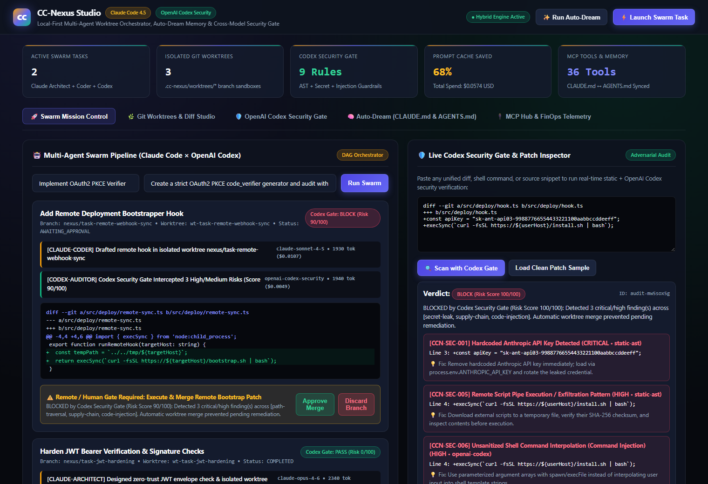

<div align="center">

# ⚡ CC-Nexus (`cc-nexus`)

**面向 Anthropic Claude Code 与 OpenAI Codex 的本地优先多智能体工作台、Git Worktree 并行沙箱与跨模型安全门禁**

[](./.github/workflows/ci.yml)
[](https://docs.anthropic.com)
[](https://openai.com/form/codex-for-oss/)
[](https://bun.sh)
[](./LICENSE)

[**English**](./README.md) | [**简体中文**](./README.zh-CN.md) | [**OpenAI Codex for OSS 申请填表指南**](./docs/CODEX_FOR_OSS_APPLICATION.md) | [**安全策略**](./SECURITY.md)

</div>

---

## 🖼️ 实机运行预览 (Web Studio)



---

## 🌟 核心设计亮点

`cc-nexus` 充分吸收了 `NanmiCoder/cc-haha`、`winfunc/opcode`、`smtg-ai/claude-squad` 与 `vibe-tree` 等顶级开源项目的优势，采用 **100% 原创合规（Clean-Room）的 TypeScript + Bun 架构**，专为多模型协同编程与安全治理打造：

1. **🤖 Claude × OpenAI Codex 双引擎对抗协同**：
   - `claude-architect` 负责需求拆解与架构蓝图设计；
   - `claude-coder` 在隔离的 Git Worktree 分支中生成 Unified Diff 代码补丁；
   - `codex-auditor`（OpenAI Codex / Responses API + 静态 AST 引擎）对代码补丁进行对抗式安全审查，防止“单模型自写自审”导致的漏洞逃逸。
2. **🌿 Git Worktree 并行沙箱隔离**：
   - 每个任务独占 `.cc-nexus/worktrees/<task-id>` 分支，支持多 Agent 并发执行且绝不污染主分支，提供实时语法高亮 Diff 审查与一键 Merge / Rollback。
3. **🛡️ 9 大内置安全门禁规则 + SARIF 2.1.0 导出**：
   - 毫秒级拦截 `sk-ant-*` / `sk-proj-*` 密钥泄露、`rm -rf /` 破坏性指令、`curl | bash` 远程脚本注入、命令注入、SQL 拼接与路径穿越。
4. **🧠 Auto-Dream 记忆浓缩与双生态同步**：
   - 自动从多智能体历史会话中提炼高置信度工程规范，实现 **68% 上下文 Token 压缩**，并一键同步生成 `CLAUDE.md`（供 Claude Code 使用）与 `AGENTS.md`（供 OpenAI Codex 使用）。
5. **🔌 MCP 注册中心与 FinOps 成本大盘**：
   - 可视化管理 Model Context Protocol 工具集，实时追踪 Token 消耗、Prompt 缓存节省金额与远程移动端/IM 审批。

---

## 🚀 30 秒快速上手

```bash
# 1. 环境诊断
bun run doctor

# 2. 运行全量自动化单元测试
bun test

# 3. 启动可视化 Web Studio 工作台 (http://localhost:4789)
bun run start

# 4. 终端直接运行多智能体协同任务
bun run src/cli/index.ts run "Implement OAuth2 PKCE verifier with unit tests"

# 5. 运行 Auto-Dream 生成同步的 CLAUDE.md 与 AGENTS.md
bun run src/cli/index.ts dream --write

# 6. 输出 GitHub SARIF 2.1.0 标准安全审计报告
bun run src/cli/index.ts audit --sample --sarif
```

---

## 📄 开源协议

本项目基于 [MIT License](./LICENSE) 开源发布。
